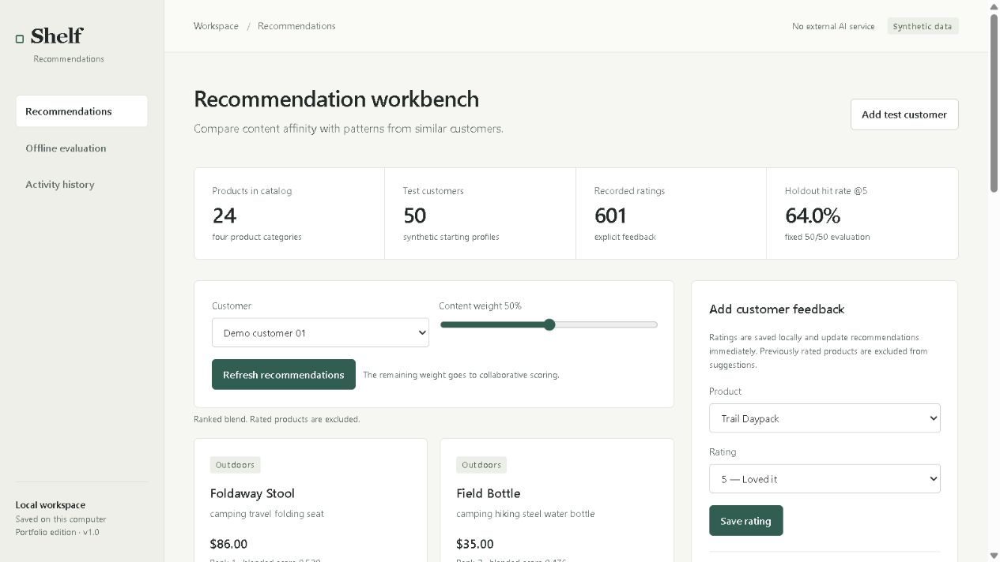

# Shelf — Recommendations

Hybrid content and collaborative recommendations with transparent score breakdowns.

## Run locally

Requires Python 3.11+. Run from this project folder:

    py -m venv .venv
    .venv\Scripts\python.exe -m pip install -r requirements.txt
    .venv\Scripts\python.exe run.py

Open http://127.0.0.1:8902. On macOS/Linux use python3 and .venv/bin/python instead. Install requirements-dev.txt and run python -m pytest -q for tests.

## Data and access

Runs on loopback. This is a local portfolio application, not a configured production service. SQLite and generated model files live in ignored data/; back up that folder. APP_DATA_DIR selects another data location. Public source contains no personal data or credentials. Demo data is synthetic and labeled. Imports stay on the local server. No paid AI API is used. HTTPS, deployment authentication and operational monitoring must be added before remote exposure.

## Ranking and evaluation

Contains a fictional 24-item catalog and 50 reproducible synthetic rating profiles. Content affinity uses TF-IDF text and a weighted profile of positively rated items. Collaborative scoring uses positively similar mean-centered rating profiles, normalized per available item. The slider blends the two scores. Previously rated products are excluded. New customers fall back to Bayesian-smoothed item popularity. Ratings persist immediately; feedback does not require an external model service.

Offline evaluation holds out one positive rating per eligible user before computing top-five recommendations with a fixed 50/50 blend. Hit rate is reported with the eligible user count. A changed slider does not change that benchmark; rerun evaluation to include new feedback. The dataset is synthetic, scores are not purchase probabilities, and no revenue/accuracy claim is made. The workbench is a local single-user experimentation tool, not a multi-tenant customer analytics service.

APIs: GET /api/state, /api/recommend, /api/audit; POST /api/customers, /api/rating, /api/evaluate.

## Interface preview

## Validation

Automated tests cover the local HTTP boundary and project-specific workflows. Browser checks cover the rendered interface and primary interactions. Dependency versions used for validation are pinned in constraints.txt. The screenshots show synthetic/example data, not customer information.
